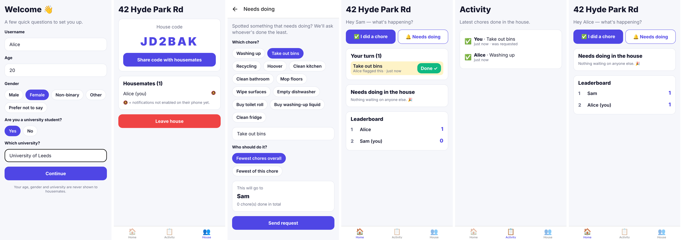
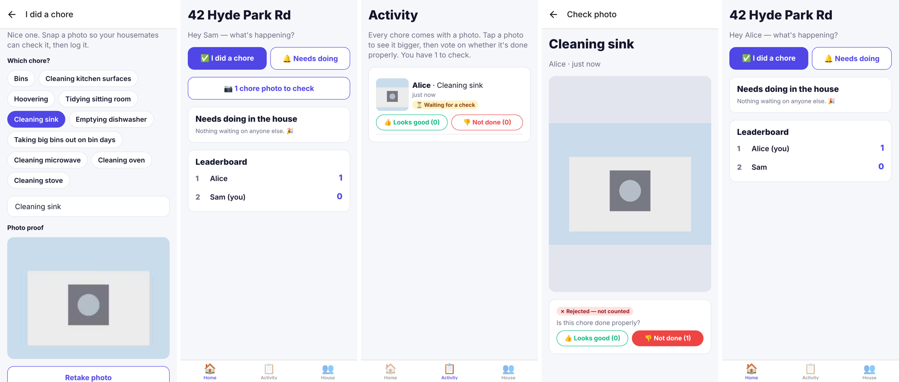

# Choreboard

A chore app for uni houses. Log chores you've done; flag chores that need doing and the app pings whoever has done the least.





## How it works

```
Open app ─► Questions (username, age, gender, student? which uni?)
          ─► Create a house (get a 6-letter code)  OR  Join with a housemate's code
          ─► Home
               ├─ ✅ "I did a chore"   ─► take a photo (required) ─► +1 on your score
               │                          ─► housemates see the photo and vote 👍 / 👎
               └─ 🔔 "Needs doing"     ─► picks who has done the fewest chores
                                           (or fewest of THAT chore, if you choose)
                                           ─► push notification to them
                                           ─► sits in their "Your turn" list until someone taps Done
```

**Photo checks:** every chore needs a camera photo, and everyone in the house can see it. Housemates vote 👍 "Looks good" or 👎 "Not done". You can't vote on your own chore, and you can change your vote.

```
no votes yet       ─► ⏳ Waiting for a check   (still counts)
more 👍 than 👎     ─► ✓ Verified               (counts; a tie also counts)
more 👎 than 👍     ─► ✗ Rejected               (removed from your score)
```

Photos are compressed and stored in Firestore, so no paid storage plan is needed. Logic: `src/lib/review.ts`.

**Who gets picked?** Never the person who flagged it. Then fewest chores (overall or of that chore). Ties go to whoever has gone longest without doing anything. Logic: `src/lib/assign.ts`.

**Privacy:** age, gender and university go in a private record that housemates can't read. Only you (the app owner) can export it (see below).

## Tech

- **App:** Expo (React Native) + Expo Router, TypeScript. One codebase for iPhone and Android.
- **Backend:** Firebase. Anonymous sign-in (no passwords) and a Firestore database. Security rules are in `firestore.rules`.
- **Notifications:** Expo push notifications.

## First-time setup

1. **Firebase project.** Go to <https://console.firebase.google.com> and create a project (the free Spark plan is fine).
   - Build → Authentication → Sign-in method → enable **Anonymous**.
   - Build → Firestore Database → Create database.
   - Project settings → Your apps → add a **Web app** and copy the config values.
2. **Config.** Copy `.env.example` to `.env.local` and paste in the values.
3. **Deploy security rules and indexes:**
   ```bash
   npx firebase-tools login
   ```
   ```bash
   npx firebase-tools deploy --only firestore --project YOUR_PROJECT_ID
   ```
4. **Run it:**
   ```bash
   npm install
   ```
   ```bash
   npx expo start
   ```
   Scan the QR code with the **Expo Go** app on your phone.

### Push notifications

Everything except notifications works in Expo Go. For notifications on a real phone you need:

```bash
npx eas-cli@latest init
```
```bash
npx eas-cli@latest build --profile development --platform android
```

`eas init` links an Expo project ID, which the app needs to get a push token. The development build is a version of the app you install yourself, because Expo Go can't receive remote notifications. Without notifications, requests still appear in the person's "Your turn" list.

## Your demographic data

To export every user's answers to a spreadsheet:

1. Firebase console → Project settings → Service accounts → **Generate new private key**. Save it as `scripts/service-account.json`. This file is git-ignored; never share it.
2. Run:
   ```bash
   cd scripts && npm install && npm run export-demographics
   ```

This writes `demographics-YYYY-MM-DD.csv` and prints a summary: % students, gender split, top universities and age range.

## Tests

```bash
npm test
```
```bash
npm run typecheck
```
```bash
npx expo lint
```
```bash
npm run test:rules
```

- `npm test` checks who-gets-picked, photo voting and house codes.
- `npm run typecheck` checks the TypeScript.
- `npx expo lint` checks code style and common mistakes.
- `npm run test:rules` checks the security rules against a local emulator and needs Java installed.

## Project layout

```
src/app/          screens (each file = a screen)
  onboarding.tsx    sign-up questions
  house-setup.tsx   create / join house
  (tabs)/home.tsx   main screen, leaderboard, "your turn"
  (tabs)/activity.tsx, (tabs)/house.tsx
  log.tsx           log a chore + take photo
  request.tsx       flag a chore for someone else
  photo/[logId].tsx full-size photo + voting
src/lib/          logic + database (assign.ts, review.ts, photos.ts, db.ts, notifications.ts)
firestore.rules   who can read/write what
scripts/          demographics export
rules-tests/      security rule tests
```
