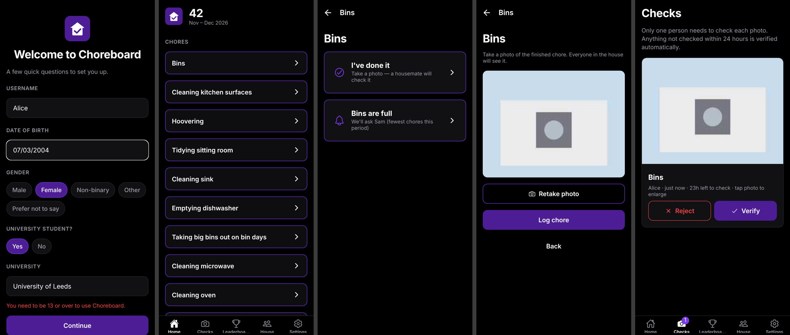
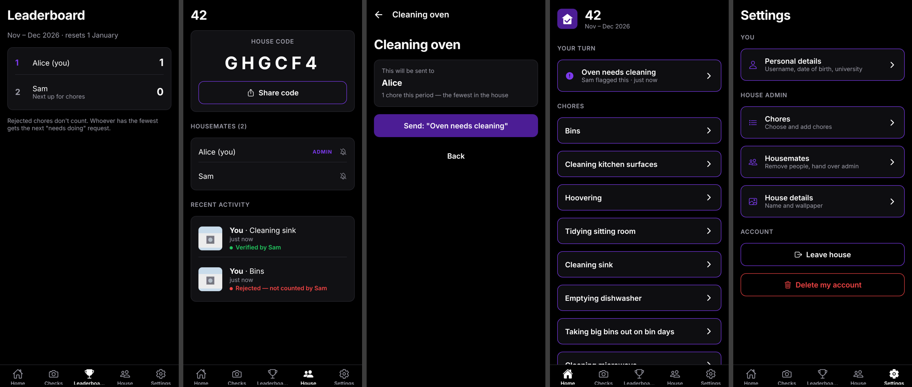
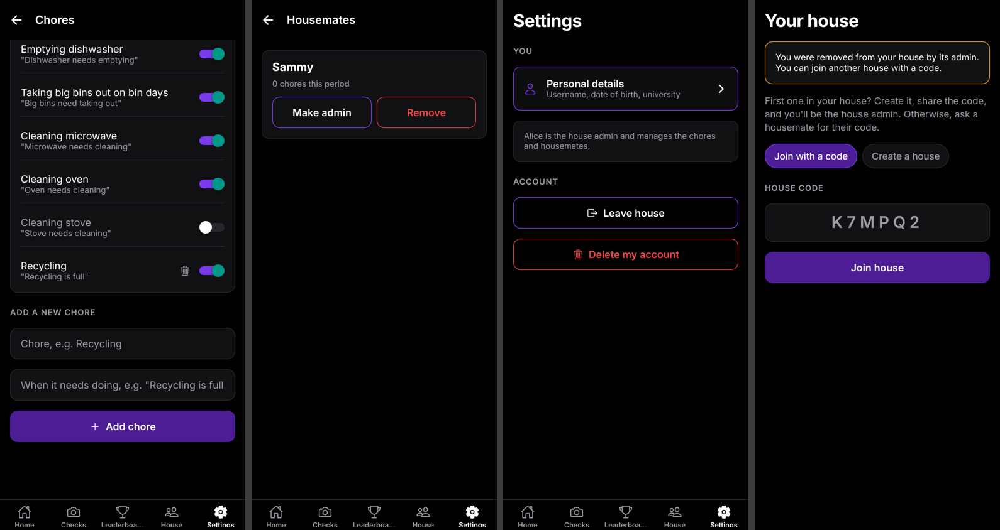
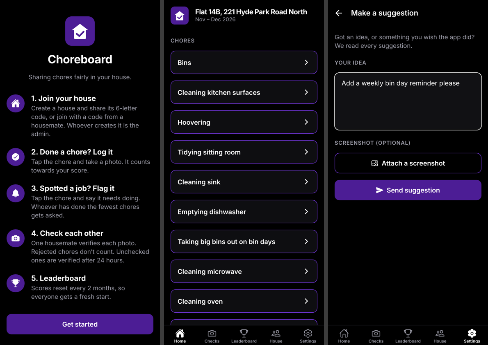

# Choreboard

A chore app for uni houses. Log chores with a photo, flag chores that need doing, and the app asks whoever has done the least.






## How it works

```
Open app ─► Questions (username, date of birth, gender, student? which uni?)
          ─► Create a house (you become ADMIN, get a 6-letter code)  OR  join with a code
          ─► Home: house name + list of chores
               Tap a chore (e.g. Bins) ─┬─► "I've done it"  ─► photo ─► +1 on your score
                                         │                       ─► housemates notified to check it
                                         └─► "Bins are full"  ─► sent to whoever has done the
                                                                  fewest chores this period
```

**Bottom menu:** Home · Checks · Leaderboard · House · Settings

- **Checks:** chore photos waiting for a check. **One** housemate verifies it, or **sends it back** with a reason (e.g. "Still dirty"), and then it disappears. A sent-back chore comes off your score and goes back on your "Your turn" list to redo. If nobody checks a photo within 24 hours, it's auto-verified. Logic: `src/lib/review.ts`.
- **Leaderboard:** resets every 2 months (Jan–Feb, Mar–Apr, …). "Who's done the fewest" uses the same 2-month count. Logic: `src/lib/period.ts`, `src/lib/assign.ts`.
- **House:** house code to share, housemates, recent activity with photos.
- **Settings:** everyone can edit their details, leave the house or delete their account. The **admin** can also switch chores on or off, add chores (with their own "needs doing" wording), remove housemates, hand over the admin role, rename the house and set a wallpaper. If the admin leaves, whoever has been in the house longest takes over.

**Paying housemates (Pay tab):** when it's your turn for a chore, you can offer it to housemates for money (£0.50–£50). Each housemate can accept or make one counter offer, and says how they want paying for that deal (Monzo link, PayPal link or cash). They do it with a photo as usual; once it's checked you pay them directly and tap "I've paid" — then the point is yours. After 2 days unpaid they can send you a reminder. The app never holds money.

**Profile pictures:** everyone picks their own in Settings: a photo (cropped in a circle) or a drawn character.

**Postcode:** creating a house asks for the postcode; only the area (e.g. "LS6 · Leeds") is saved, via postcodes.io.

**Privacy:** sign-up has a tick-box to agree to the privacy policy (in the app at /privacy; the text is in `src/components/PrivacyPolicy.tsx`, and your name and contact email go in `src/lib/legal.ts`). Changing `PRIVACY_VERSION` there asks everyone to agree again.

**Owner dashboard:** Settings → App owner → Dashboard (owners only; set up like the Feedback inbox). Users, houses, activity, chores, paid deals, sign-ups per week, age, gender, universities and house areas, plus an anonymous CSV download on the web.

**Haptics:** gentle vibrations on taps (phone app only; Safari can't vibrate). Can be turned off in Settings.

**Leaderboard resets:** every 2 months by default. The house admin can choose 1, 3 or 6 months, or custom dates (e.g. a uni term), in Settings → House details.

**Feedback:** in Settings, anyone can **report a bug** or **make a suggestion**, optionally with a screenshot. These are saved in the database, and only you can read them, in the app's Feedback inbox (see "Feedback" below).

**Privacy:** date of birth, gender and university go in a private record that housemates can't read. Only you (the app owner) can export it (see below).

## Tech

- **App:** Expo (React Native) + Expo Router, TypeScript. One codebase for iPhone and Android.
- **Backend:** Firebase. Anonymous sign-in (no passwords) and a Firestore database. Security rules are in `firestore.rules`.
- **Notifications:** Expo push notifications.

## First-time setup

1. **Firebase project.** Go to <https://console.firebase.google.com> and create a project (the free Spark plan is fine).
   - Build → Authentication → Sign-in method → enable **Anonymous**.
   - Build → Firestore Database → Create database.
   - Project settings → Your apps → add a **Web app** and copy the config values.
2. **Config.** Copy `.env.example` to `.env.local` and paste in the values.
3. **Deploy security rules and indexes:**
   ```bash
   npx firebase-tools login
   ```
   ```bash
   npx firebase-tools deploy --only firestore --project YOUR_PROJECT_ID
   ```
4. **Run it:**
   ```bash
   npm install
   ```
   ```bash
   npx expo start
   ```
   Scan the QR code with the **Expo Go** app on your phone.

### Push notifications

Everything except notifications works in Expo Go. For notifications on a real phone you need:

```bash
npx eas-cli@latest init
```
```bash
npx eas-cli@latest build --profile development --platform android
```

`eas init` links an Expo project ID, which the app needs to get a push token. The development build is a version of the app you install yourself, because Expo Go can't receive remote notifications. Without notifications, requests still appear in the person's "Your turn" list.

## Your demographic data

To export every user's answers to a spreadsheet:

1. Firebase console → Project settings → Service accounts → **Generate new private key**. Save it as `scripts/service-account.json`. This file is git-ignored; never share it.
2. Run:
   ```bash
   cd scripts && npm install && npm run export-demographics
   ```

This writes `demographics-YYYY-MM-DD.csv` and prints a summary: % students, gender split, top universities and age range.

## Feedback

Bug reports and suggestions are saved in Firestore → `feedback`. The easiest way to read them is the **Feedback inbox** in the app (Settings → App owner), which shows screenshots and lets you tick reports off.

**Turn on the inbox for your account (once per phone/browser):**
1. In the app, go to Settings and scroll to the bottom. Copy your **Account ID**.
2. Firebase console → Firestore Database → **Start collection** (or **+ Add collection**) → Collection ID `owners`.
3. Document ID: paste your Account ID. Add one field: `name` (string) = your name. Save.
4. Close and reopen the app. "Feedback inbox" appears at the top of Settings.

Only accounts listed in `owners` can read feedback (see `firestore.rules`). Nobody can add themselves from the app.

To get everything as a spreadsheet instead, with screenshots saved as pictures (uses the same `service-account.json` as the demographics export):

```bash
cd scripts && npm install && npm run export-feedback
```

This creates `feedback-YYYY-MM-DD.csv` plus a folder of screenshots.

## Releasing a beta (TestFlight / Google Play)

App builds are made in the cloud with EAS (`eas.json`). The app ID is `com.charlesphillips.choreboard`.

1. Copy your Firebase settings so the cloud build can see them (`.env.local` is never uploaded):
   ```bash
   cp .env.local .env
   ```
2. Link the project to your Expo account (this adds a project ID, which push notifications need):
   ```bash
   npx eas-cli@latest init
   ```
3. iPhone: build, then send the build to TestFlight. This needs an Apple Developer account.
   ```bash
   npx eas-cli@latest build --platform ios --profile production
   ```
   ```bash
   npx eas-cli@latest submit --platform ios --latest
   ```
4. Android: build an installable test file (`.apk`) and share the link it gives you:
   ```bash
   npx eas-cli@latest build --platform android --profile preview
   ```
5. Web link (free; iPhone testers can "Add to Home Screen", but there are no notifications):
   ```bash
   npx expo export --platform web
   ```
   ```bash
   npx eas-cli@latest deploy --prod
   ```

A privacy policy is required by the App Store. There's a draft in `docs/privacy-policy.md`.

## Tests

```bash
npm test
```
```bash
npm run typecheck
```
```bash
npx expo lint
```
```bash
npm run test:rules
```

- `npm test` checks who-gets-picked, photo checks, 2-month periods, date of birth, chore lists and house codes.
- `npm run typecheck` checks the TypeScript.
- `npx expo lint` checks code style and common mistakes.
- `npm run test:rules` checks the security rules against a local emulator and needs Java installed.

## Project layout

```
src/app/          screens (each file = a screen)
  onboarding.tsx    sign-up questions
  house-setup.tsx   create / join house
  (tabs)/home.tsx   house name, "your turn", chore list
  chore/[key].tsx   tap a chore: "done it" (photo) or "needs doing"
  photo/[logId].tsx full-size photo
  (tabs)/checks.tsx, leaderboard.tsx, house.tsx
  (tabs)/settings/  personal details + admin pages
src/lib/          logic + database (assign, review, period, dob, chores, photos, db, notifications)
firestore.rules   who can read/write what
scripts/          demographics export
rules-tests/      security rule tests
```
